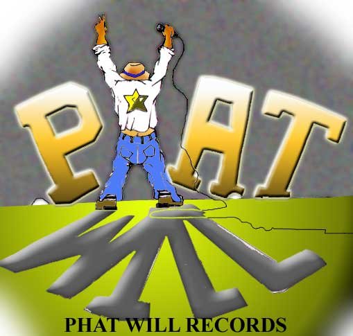

# Phat Will Studio

**A free desktop music studio for Windows and Mac.** Record, make beats, compose, mix and export music in any genre - with a home in hip-hop, rap, jazz and funk. Works completely offline: no account, no sign-in, no internet needed.

## Download (version 0.7.0)

| Computer | Download | Size |
| --- | --- | --- |
| **Windows** 10 or 11 (64-bit) | [PhatWillStudio-0.7.0-win64.exe](https://github.com/demondcomics-816/phat-will-studio-downloads/releases/download/v0.7.0/PhatWillStudio-0.7.0-win64.exe) | 3.4 MB |
| **Mac** - macOS 11 Big Sur or later, Apple silicon and Intel | [PhatWillStudio-0.7.0-macOS-universal.dmg](https://github.com/demondcomics-816/phat-will-studio-downloads/releases/download/v0.7.0/PhatWillStudio-0.7.0-macOS-universal.dmg) | 9.9 MB |

All versions: [Releases page](https://github.com/demondcomics-816/phat-will-studio-downloads/releases)

## Install

**Windows**
1. Run the downloaded `.exe`.
2. Windows may say *"Windows protected your PC"* because the installer is not yet signed with a paid certificate. Click **More info**, then **Run anyway**.
3. Follow the installer. Start Phat Will Studio from the Start menu. Uninstall any time from *Settings > Apps*.

**Mac**
1. Open the downloaded `.dmg` and drag **Phat Will Studio** into **Applications**.
2. The first time, **right-click** (or Control-click) the app in Applications and choose **Open**, then **Open** again. (The app is not yet notarised by Apple, so a normal double-click is blocked the first time only.) If macOS still refuses, open *System Settings > Privacy & Security* and click **Open Anyway**.
3. Allow microphone access when asked if you want to record.

## What you get

- **Opens ready to play**: a starter song (drums, bass, chords) - press **Space**.
- **21 genre templates**: boom bap, trap, lo-fi, rock, pop, ballad, funk, R&B, gospel, jazz swing, bossa nova, reggae, house, disco, drum & bass, metal, country, classical waltz (3/4), 6/8 ballad, Afro-Cuban 12/8, 5/4.
- **Built-in instruments**: Phat Drums (7 kits) and two Phat Synths - Bass and Keys - with analog, electric piano, organ, strings/pads, guitar/harp and piano engines and 28 presets.
- **A 91-sound library** created on first launch (Documents/Phat Will Studio/Sound Library): drum hits, instrument notes and genre loops, free to use in your music.
- **Recording** (24-bit, count-in, punch-in, take comping), **arrangement editing** (trim, fades, split, time-stretch, transpose), **piano roll** with controller lanes, **patterns and song mode**, **tempo changes and time signatures**.
- **Mixing**: mixer, effects on every track and channel, master effects, automation, VST3 plug-ins (and Audio Units on Mac).
- **Export**: WAV, FLAC, MP3 (Windows), AAC, Ogg, stems and MIDI.

## Tested

Each release is built and tested automatically on clean Windows and Mac machines: the installer is installed, the app runs a full self-test (record, play, save, reopen, undo, export in every format), and is then uninstalled. On the Mac, real audio playback and recording through Core Audio and Apple's own Audio Unit plug-ins are tested too.

## Known limits

- Installers are not yet signed with paid Microsoft/Apple certificates (hence the warnings above).
- The Mac version has been tested on Apple's cloud Macs but not yet by people with physical audio interfaces - please report problems.
- See the release notes for the full list.

## Support

Questions or problems: [open an issue](https://github.com/demondcomics-816/phat-will-studio-downloads/issues).

---
Phat Will Studio is © Phat Will Records. Built with JUCE. Third-party plug-ins remain under their own licences.
